# Arhitektura upravljanja organizacijom `catholicit`

Ovaj dokument opisuje kako se organizacija **github.com/catholicit** upravlja
bez administratora: tko odlučuje, kako se glasa, što bot radi, gdje je
povjerenje još uvijek potrebno i kamo sustav ide (Safe multisig na Gnosis
Chainu, Radicle).

Sadržaj:

1. [Ideja u jednoj rečenici](#1-ideja-u-jednoj-rečenici)
2. [Sudionici i njihova prava](#2-sudionici-i-njihova-prava)
3. [Životni ciklus prijedloga](#3-životni-ciklus-prijedloga)
4. [Pravilo glasanja](#4-pravilo-glasanja)
5. [Usklađivanje organizacije (`apply`)](#5-usklađivanje-organizacije-apply)
6. [`org.yaml` i `governance.yml`, referenca](#6-orgyaml-i-governanceyml-referenca)
7. [Sigurnost workflowa](#7-sigurnost-workflowa)
8. [Model povjerenja: gdje je centralizacija](#8-model-povjerenja-gdje-je-centralizacija)
9. [Safe, Gnosis i Chiado](#9-safe-gnosis-i-chiado)
10. [Faze](#10-faze)
11. [Upute za svakodnevni rad](#11-upute-za-svakodnevni-rad)
12. [Postavljanje od nule](#12-postavljanje-od-nule)
13. [Uzori: što je preuzeto, a što je novo](#13-uzori-što-je-preuzeto-a-što-je-novo)

---

## 1. Ideja u jednoj rečenici

**Nitko nema više moći od ostalih: stanje organizacije je datoteka, datoteka se
mijenja samo većinom glasova, a promjenu provodi bot koji ne zna ništa drugo.**

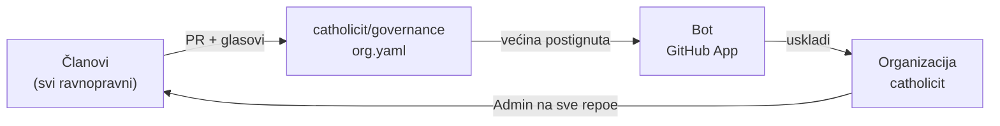

Usporedba s WhatsApp ili Telegram grupom: tamo su svi admini, ali svaki admin
može izbaciti druge. Ovdje nitko ne može sam izbaciti nikoga. Može samo
predložiti, a odlučuje većina.

---

## 2. Sudionici i njihova prava

| Tko | Gdje | Prava | Može sam |
|---|---|---|---|
| **Član** | tim `core` | **Admin** na sve repoe osim `governance`, **Read** na `governance` | sve na kodu: repoi, issueji, Actions, postavke repoa; predložiti i glasati |
| **Bot** `catholicit-governance` (GitHub App) | instaliran na org, sve repoe | pokreće Peribolos (članstvo, timovi, postavke), merge u `governance` | ništa po vlastitoj volji, samo ono što piše na `main` |
| **Owner** (`stepanic`, `prilikazasusretsync`) | `admins:` u `org.yaml`, barem 2 | sve, uključujući isključiti pravila | svaki potez je javan, a `apply` ga dnevno poništava |
| **Bilo tko na GitHubu** | — | forkati `governance`, otvoriti PR | predložiti da postane član |

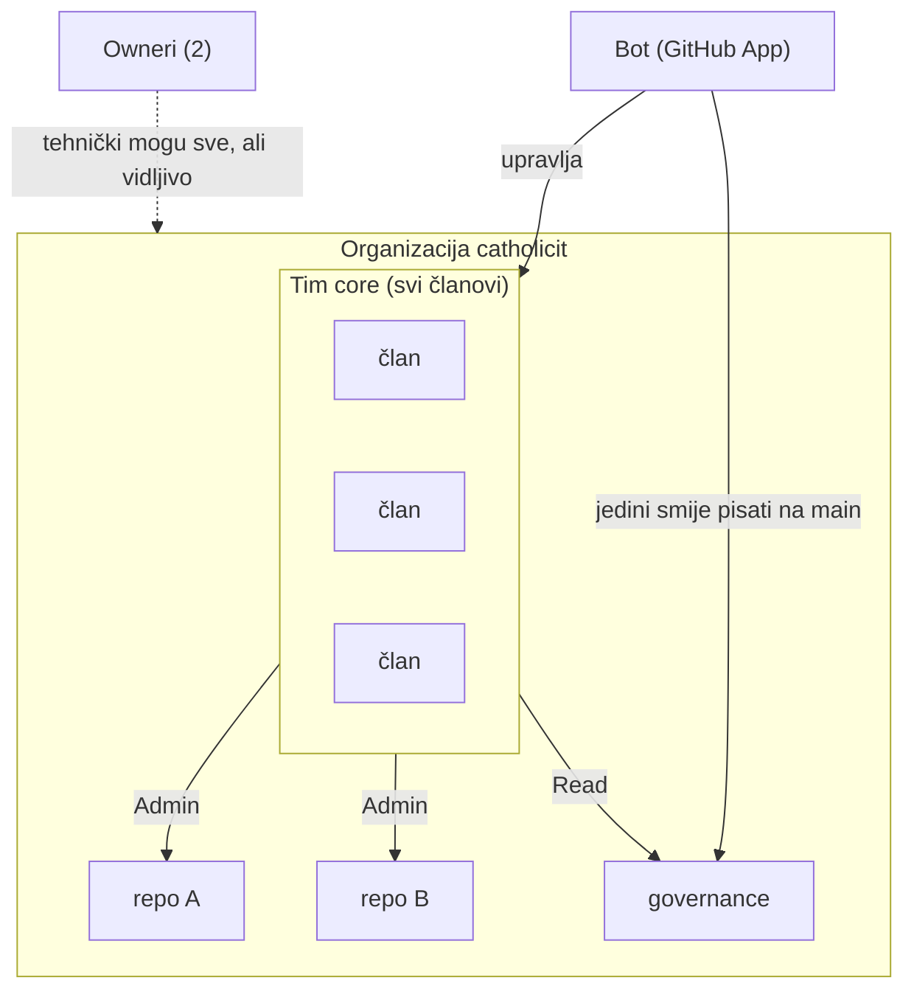

Grana `main` u `governance` zaštićena je rulesetom `main-samo-glasanjem`: nema
brisanja, nema force pusha i nema nikakve izmjene, osim za bota. Zato ni Owner
ne može izravno pushati. Mora isključiti pravilo, a to ostavlja trag.

---

## 3. Životni ciklus prijedloga

Svaka promjena (novi član, izbacivanje, pravila glasanja, kod samog bota) je
pull request na `main`.

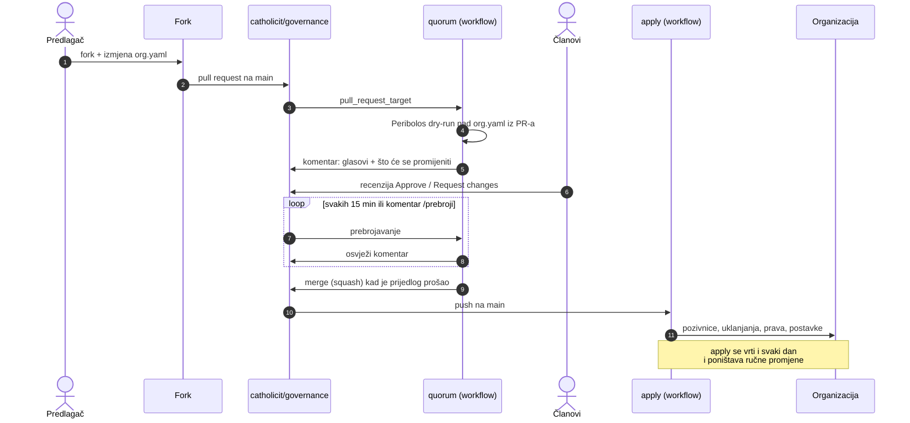

Stanja prijedloga:

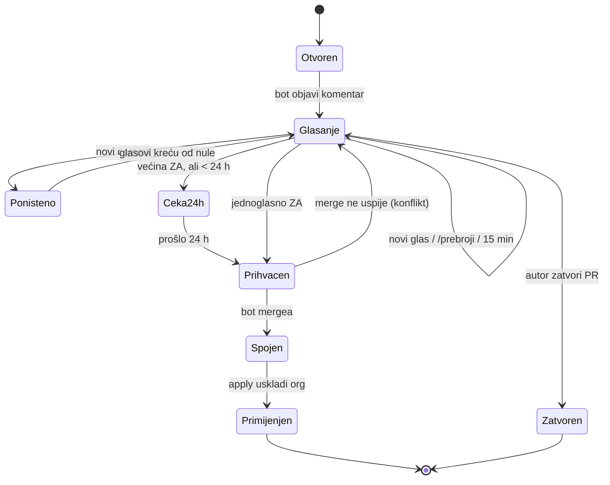

---

## 4. Pravilo glasanja

- **Glasači** su svi pod `admins` i `members` u `org.yaml` **na `main`**, ne iz prijedloga.
  Prijedlog koji dodaje 10 novih članova ne može ih iskoristiti za vlastito
  izglasavanje.
- **Glas** je recenzija na **zadnjem commitu** PR-a: Approve je ZA, Request
  changes je PROTIV. Vrijedi zadnja recenzija svakog člana.
- **Novi commit poništava sve glasove.** Nitko ne može dobiti glasove za jedan
  tekst pa zatim podmetnuti drugi.
- **Autor-član** računa se kao ZA, osim ako je sam stavio Request changes.
- **Prag:** `floor(n/2) + 1` glasova ZA, gdje je `n` broj članova.
- **Rok:** prijedlog mora biti otvoren barem `min_open_hours` (24 h), da ga
  svi stignu vidjeti. **Jednoglasan** prijedlog prolazi odmah.
- **Draft** PR se nikad ne spaja.

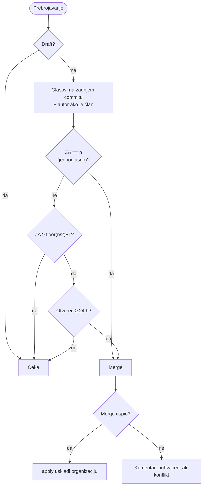

| Članova `n` | Potrebno ZA |
|---|---|
| 1 | 1 |
| 2 | 2 |
| 3 | 2 |
| 5 | 3 |
| 9 | 5 |
| 20 | 11 |

Pravila glasanja i sam kod bota mijenjaju se istim postupkom. Većina može
promijeniti i prag, ali samo uz trenutni prag.

---

## 5. Usklađivanje organizacije (`apply`)

Primjenu radi **[Peribolos](https://docs.prow.k8s.io/docs/components/cli-tools/peribolos/)**,
alat iz Kubernetesova Prow ekosustava, isti koji upravlja organizacijama
`kubernetes`, `kubernetes-sigs`, `knative` i `istio`. Ne izmišljamo vlastiti
mehanizam, nego uzimamo provjeren. Kontejner je pinan na točnu verziju u
`scripts/peribolos.sh` i mijenja se samo glasanjem.

Peribolos nema "sve repoe" pa bi s `--fix-team-repos` timu `core` oduzeo prava
na svaki repo koji nije izričito naveden. Zato `scripts/render.py` prije
primjene dopiše sve repoe organizacije prema pravilu `all_repos` iz
`governance.yml`. To je jedini naš dodatak između `org.yaml` i Peribolosa.

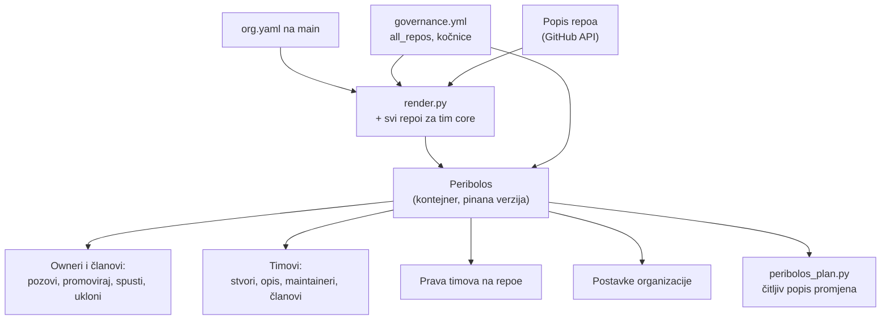

Peribolosove sigurnosne kočnice (vrijednosti u `governance.yml`):

| Zastavica | Vrijednost | Značenje |
|---|---|---|
| `--min-admins` | 2 | konfiguracija mora imati barem 2 Ownera; Peribolos manje ni ne dopušta |
| `--maximum-removal-delta` | 0.5 | odbija korak koji uklanja više od pola članstva (Kubernetes koristi 0.25, ali u maloj grupi bi to blokiralo svako uklanjanje) |
| `--confirm` | samo u `apply` | bez nje Peribolos samo ispiše što bi napravio |
| `--require-self` | false | izvršitelj je App, a ne korisnički račun, pa ne može biti na popisu admina |

Kada se `apply` pokreće:

| Okidač | Način |
|---|---|
| push na `main` (tj. spojen prijedlog) | primjena |
| svaki dan 04:17 UTC | primjena, poništava ručne promjene |
| ručno, Actions → apply → Run workflow | dry-run po zadanom |

---

## 6. `org.yaml` i `governance.yml`, referenca

**`org.yaml`** je standardni Peribolosov format (vidi
[kubernetes/org](https://github.com/kubernetes/org/blob/main/config/kubernetes/org.yaml)
za veliki primjer). Svi navedeni pod `admins` i `members` su glasači.

```yaml
orgs:
  catholicit:
    default_repository_permission: read
    members_can_create_repositories: true
    admins:                 # Owneri, barem 2
      - prilikazasusretsync
      - stepanic
    members: []             # ostali članovi
    teams:
      core:
        description: Svi članovi, ravnopravni
        privacy: closed
        maintainers:        # Owneri su u timu uvijek maintaineri
          - prilikazasusretsync
          - stepanic
        members: []         # svi ostali članovi
        repos:
          governance: read  # iznimka od all_repos
```

**`governance.yml`** su naša pravila iznad Peribolosa:

```yaml
quorum:
  majority: true            # floor(n/2) + 1
  min_open_hours: 24        # osim kad je jednoglasno

all_repos:                  # render.py: tim dobiva ovo pravo na sve repoe
  team: core
  permission: admin

peribolos:
  min_admins: 2
  maximum_removal_delta: 0.5

safe:                       # faza 3, vidi poglavlje 9
  active: chi
  gno:                      # 0x... Safe na Gnosis Chainu
  chi:                      # 0x... Safe na Chiado testnetu

evm:                        # adresa walleta po GitHub korisniku
  stepanic:                 # 0x..., ista na svim EVM lancima
```

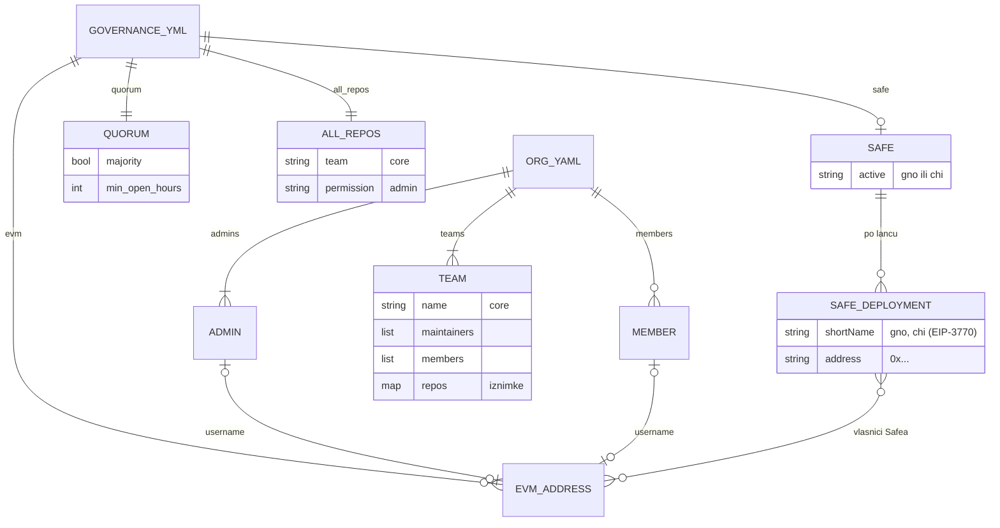

---

## 7. Sigurnost workflowa

Članovi nemaju pravo pisanja u `governance`, pa prijedlozi dolaze iz forkova.
Workflowi su napravljeni tako da kod iz prijedloga **nikad ne dobije ključ
bota**:

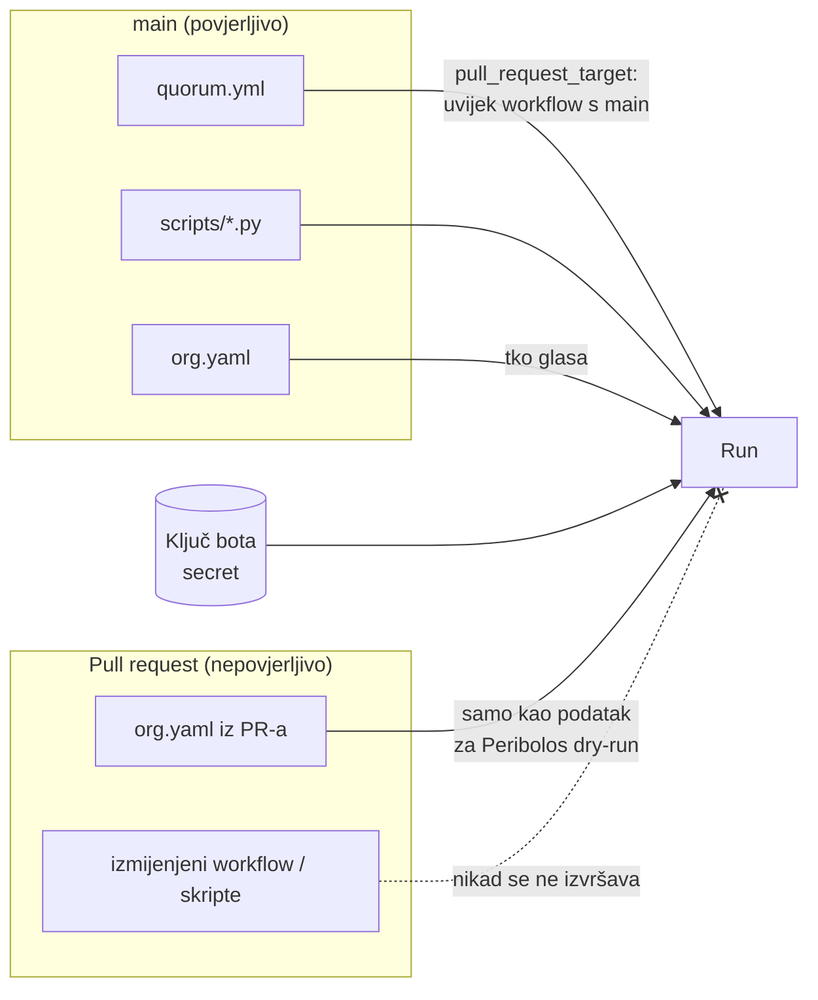

- `pull_request_target` i `issue_comment` uvijek izvršavaju workflow s `main`.
- Checkout je uvijek `main`; kod iz PR-a se ne checkouta i ne pokreće.
- `org.yaml` iz PR-a dohvaća se preko API-ja i predaje Peribolosu u dry-runu
  (bez `--confirm`) samo kao podatak, za prikaz plana.
- Promjena workflowa ili skripti djeluje tek kad je **izglasana i spojena**.
- `permissions: {}` na `GITHUB_TOKEN`-u; sve ide preko kratkotrajnog tokena
  bota (vrijedi 1 h).

---

## 8. Model povjerenja: gdje je centralizacija

Iskreno: **na GitHubu se centralizacija ne može ukloniti, može se samo smanjiti
i učiniti vidljivom.**

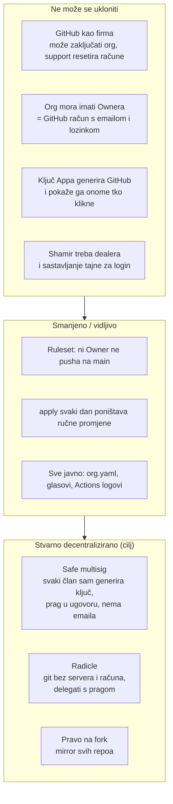

**Zaključak:** GitHub je **sučelje**, a ne izvor legitimiteta. Legitimitet je u
Safeu (tko je član, što je izglasano), a zadnja garancija je **pravo na
fork**. Ako skrbnik bot računa ikad postupi mimo odluka, to je javno vidljivo
(stanje GitHuba se ne poklapa sa Safeom), a zajednica s istim Safeom i istim
kodom (mirror) nastavlja drugdje. Otmica GitHub organizacije time postaje
besmislena. Skrbnik nije vlast nego **zamjenjivi operater**.

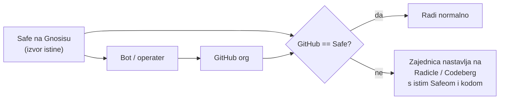

### Može li Owner biti trajno zaključan?

Tehnički da: račun s nasumičnom lozinkom koja se ne spremi, 2FA bez
sačuvanih recovery kodova, bez SSH ključeva i tokena. Do njega tada ne može
nitko, a GitHub support u pravilu ni ne vraća takve račune. Zašto to (još) ne
radimo:

- **Ne može se dokazati da je zaboravljeno.** Onaj tko provodi ceremoniju mogao
  je potajno spremiti lozinku, a audit log organizacije na Free planu vide samo
  Owneri.
- **Organizacija se zamrzne** za sve što smije samo Owner: odobravanje novih
  dozvola Appu, **opoziv procurjelog ključa Appa**, promjena plana.
- **Peribolos traži barem 2 Ownera** (`--min-admins` ne prima manje od 2).
- Izlaz u nuždi postoji samo ako App smije promovirati Ownera glasanjem. Prvi
  test toga je upravo `apply` koji poziva drugog Ownera iz `org.yaml`.

Zato je to faza 4, eksperiment, kad bude dovoljno članova.

---

## 9. Safe, Gnosis i Chiado

### Adrese članova: bez lanca

Isti privatni ključ daje **istu adresu na svim EVM lancima** (Ethereum, Gnosis,
Chiado...). Zato član u `governance.yml` pod `evm:` ima samo adresu, bez
oznake lanca.

Iznimka: ako netko kao osobni wallet koristi smart contract wallet (npr.
vlastiti Safe), ta adresa postoji samo na lancu gdje je deployan. Takav član
mora imati wallet na Gnosisu.

### Safe: po lancu

Safe je ugovor deployan na konkretnom lancu, pa se navodi po lancu. Ključ je
**EIP-3770 kratko ime**, isto kao u Safe URL-ovima
(`app.safe.global/home?safe=gno:0x...`):

| Ključ | Lanac | chainId | Namjena |
|---|---|---|---|
| `gno` | Gnosis Chain | 100 | produkcija |
| `chi` | Chiado | 10200 | testnet, proba |

Safe na dva lanca ima istu adresu samo ako je deployan s istim vlasnicima,
pragom i saltom. Zato je `safe:` mapa, a ne jedna adresa. `active` kaže koji
lanac `quorum` provjerava.

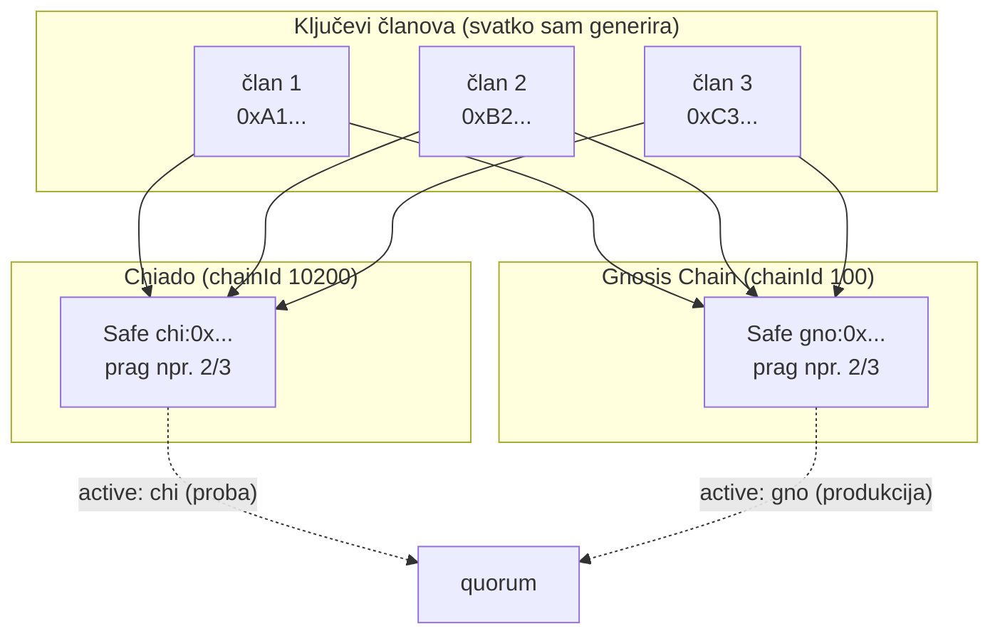

### Kako će glasanje Safeom raditi (faza 3)

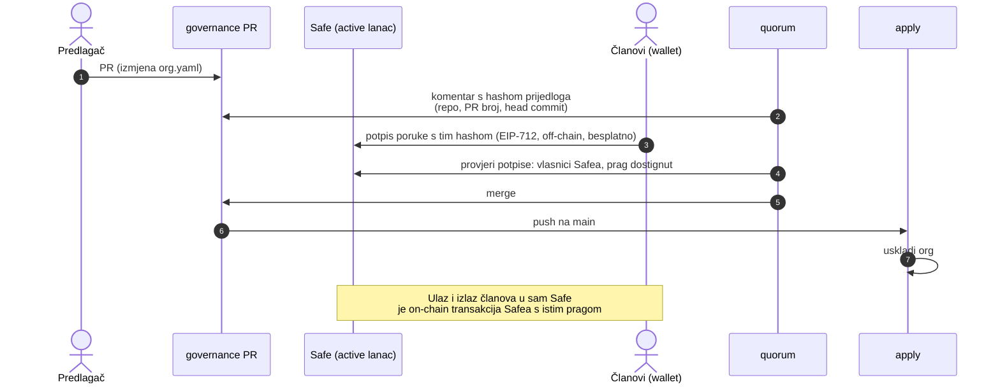

Planirano:

- **Dokaz vlasništva adrese:** član potpiše poruku
  `catholicit: github=<username>`, bot provjeri da potpis odgovara `evm`
  adresi. Nitko ne može upisati tuđu adresu.
- **Sinkronizacija:** popis vlasnika Safea i glasača iz `org.yaml` moraju se poklapati;
  `apply` prijavljuje razliku.
- Potpisi su off-chain (EIP-712 / Safe message), pa glasanje ne košta gas.
  On-chain su samo promjene vlasnika i praga Safea, koje na Gnosisu koštaju
  djelić centa.

---

## 10. Faze

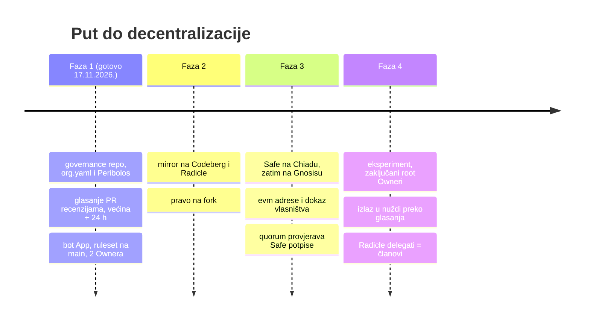

---

## 11. Upute za svakodnevni rad

### Pridruživanje

1. Fork `catholicit/governance`.
2. U `org.yaml` dodaj svoj username pod `members:` i pod `members:` tima
   `core`:
   ```yaml
       members:
         - tvoj-username
       teams:
         core:
           members:
             - tvoj-username
   ```
   Neobavezno, u `governance.yml` pod `evm:` dodaj `tvoj-username: 0x...`.
3. Otvori PR. Bot u komentar upiše stanje glasanja.
4. Kad prođe, prihvati pozivnicu na
   <https://github.com/orgs/catholicit/invitation>.

### Glasanje

- **Files changed → Review changes → Approve** (ZA) ili **Request changes**
  (PROTIV).
- Komentar `/prebroji` odmah ponovno broji; inače se broji svakih 15 minuta.

### Izlazak ili izbacivanje

PR koji briše člana iz `org.yaml` (pod `members` i iz tima `core`). Nakon spajanja bot ga makne iz tima i
organizacije i otkaže pozivnicu ako je još visi.

### Provjera bez promjena

Actions → **apply** → Run workflow → `dry_run` uključen. Ili lokalno:

```bash
GH_TOKEN=$(gh auth token) python3 scripts/render.py > /tmp/rendered.yaml
(umask 077; gh auth token > /tmp/tok)
PERIBOLOS_TOKEN_FILE=/tmp/tok scripts/peribolos.sh /tmp/rendered.yaml 2>&1 | python3 scripts/peribolos_plan.py
rm /tmp/tok
```

### Ako nešto zapne

| Simptom | Uzrok | Rješenje |
|---|---|---|
| Komentar kaže "prihvaćen, ali spajanje nije uspjelo" | konflikt s `main` | autor rebasea; glasovi se poništavaju |
| Bot ne komentira | workflow isključen nakon 60 dana neaktivnosti (GitHub pravilo za cron) | Actions → quorum → Enable |
| `apply` pada s 401/403 | ključ Appa istekao ili opozvan | novi ključ u App postavkama, `gh secret set GOVERNANCE_APP_PRIVATE_KEY` |
| Glas nije prebrojen | recenzija je na starijem commitu | ponovno Approve na zadnjem commitu |

---

## 12. Postavljanje od nule

Za slučaj da se sustav mora ponovno podići (npr. u novoj organizaciji):

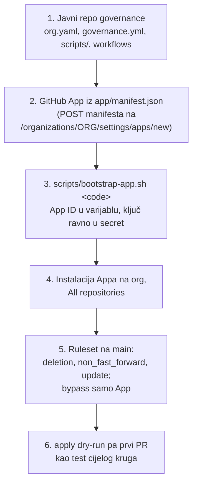

Dozvole Appa: `members`, `organization_administration`, `administration`,
`contents`, `workflows` (da može spojiti PR koji mijenja workflow),
`pull_requests`, `issues` za pisanje te `metadata` za čitanje.

Stvarne vrijednosti za `catholicit`: App `catholicit-governance`, ID `5799464`,
ruleset `main-samo-glasanjem`.

---

## 13. Uzori: što je preuzeto, a što je novo

Sustav je sastavljen od dijelova koji već postoje u javnim GitHub
organizacijama. **Sama kombinacija** (glasanje većinom koje upravlja članstvom
cijele organizacije, s planom prelaska na Safe) **nije ustaljena praksa** i
nisam našao javni repo koji je radi ovako. Provjereno 17.11.2026.

### Organizacija kao kod (`org.yaml` + Peribolos)

| Repo | Što radi | Razlika od nas |
|---|---|---|
| [kubernetes/org](https://github.com/kubernetes/org) | `config/kubernetes/org.yaml` opisuje članove, timove i prava; alat **Peribolos** primjenjuje promjene nakon merge-a | PR odobravaju org admini, ne većina članova |
| [kubernetes-sigs/prow](https://github.com/kubernetes-sigs/prow) | izvor alata Peribolos (`site/content/en/docs/components/cli-tools/peribolos.md`) | alat, ne pravilo glasanja |
| [knative/community](https://github.com/knative/community) | direktorij `peribolos/`, isti model kao Kubernetes | isto |
| [istio/community](https://github.com/istio/community) | governance materijal, članstvo kroz PR | isto |
| [rust-lang/team](https://github.com/rust-lang/team) | `people/`, `teams/`, `repos/` u TOML-u; sinkronizacija na GitHub timove i prava | odobravaju vođe timova |
| [github-community-projects/safe-settings](https://github.com/github-community-projects/safe-settings) | postavke repoa i organizacije kao kod (GitHub App) | ne upravlja glasanjem |

Odatle je preuzeto: **stanje organizacije je datoteka, promjena je PR, bot
uskladi**. Tamo PR odobravaju imenovani admini (vlasnici `OWNERS` datoteka).
Ovdje ga odobrava većina članova.

### Spajanje PR-ova glasanjem

| Repo | Što radi |
|---|---|
| [botwillacceptanything/botwillacceptanything](https://github.com/botwillacceptanything/botwillacceptanything) | bot spaja PR kad dobije dovoljno glasova; neaktivno od 2022. |
| [Chaosthebot/Chaos](https://github.com/Chaosthebot/Chaos) | "kod koji se demokratski sam mijenja": PR-ovi se spajaju glasanjem reakcijama; neaktivno od 2019. |
| [openpolitics/manifesto](https://github.com/openpolitics/manifesto) | politički manifest koji se mijenja glasanjem na PR-ovima; neaktivno od 2022. |

Odatle je preuzeto: **bot broji glasove na PR-u i sam spaja**. Ti su projekti
glasanjem mijenjali sadržaj repoa, ne članstvo i prava cijele organizacije.
Neki su brojali i reakcije bilo koga, a ovdje glasaju samo članovi s `main`,
glas vrijedi samo za zadnji commit, a novi commit poništava glasove.

### Što je ovdje novo (i zato neprovjereno praksom)

- Spoj tih dvaju uzoraka: **većina članova upravlja članstvom i pravima**
  cijele organizacije, bez imenovanih admina.
- **Ruleset koji ni Ownera ne pušta na `main`**, uz bota kao jedinu iznimku.
- **Safe multisig kao izvor istine za GitHub organizaciju** (faza 3). Za to
  nisam našao javni primjer, pa je to eksperiment.

Ovaj sustav je zato **mlad i nije provjeren u praksi**. Kubernetes i Rust
pokazuju da "organizacija kao kod" radi s mnogo ljudi. Chaos i
botwillacceptanything pokazuju da glasanje botom radi, ali i da takvi projekti
zamru kad interes padne.

Poznata slabost ovdašnjeg pravila: prag je većina **od svih članova**, pa
neaktivan član u praksi glasa PROTIV. Ako zajednica naraste, vjerojatno treba
ili pravilo za uklanjanje neaktivnih članova, ili prag računat od onih koji su
glasali uz minimalni odaziv (kvorum).
