# Radicle: topologija čvorova, repoa i ljudi

Ovaj dokument objašnjava kako je [Radicle](https://radicle.dev) organiziran.
Polazi od fizičkih računala, preko git repoa na njima, do ljudi koji svojim
ključevima potpisuju promjene. Cilj je da se odnosi među entitetima vide kao
mapa u 2D prostoru. Uz to je skica kako bi se `catholicit` preslikao na taj
model. Napisano u studenom 2026., za Radicle 1.10.x (protokol *Heartwood*).

Sadržaj:

1. [Sažetak](#1-sažetak)
2. [Rječnik entiteta](#2-rječnik-entiteta)
3. [Svijet: fizički čvorovi i gossip mreža](#3-svijet-fizički-čvorovi-i-gossip-mreža)
4. [Ljudi, ključevi, uređaji, čvorovi](#4-ljudi-ključevi-uređaji-čvorovi)
5. [Unutar jednog čvora: storage i repoi](#5-unutar-jednog-čvora-storage-i-repoi)
6. [Unutar jednog repoa: prostori imena i refovi](#6-unutar-jednog-repoa-prostori-imena-i-refovi)
7. [Model entiteta (ER)](#7-model-entiteta-er)
8. [Tok: od commita do kanonskog `main`a](#8-tok-od-commita-do-kanonskog-maina)
9. [Tok: patch od nedelegata](#9-tok-patch-od-nedelegata)
10. [Isti repo, različit pogled sa svakog čvora](#10-isti-repo-različit-pogled-sa-svakog-čvora)
11. [Primjer: `catholicit` na Radicleu](#11-primjer-catholicit-na-radicleu)
12. [Što ni Radicle ne decentralizira](#12-što-ni-radicle-ne-decentralizira)
13. [Tim kroz vrijeme: dolasci i odlasci](#13-tim-kroz-vrijeme-dolasci-i-odlasci)
14. [Disk i otkrivanje: usporedba s blockchain čvorom](#14-disk-i-otkrivanje-usporedba-s-blockchain-čvorom)
15. [Codeberg i Radicle](#15-codeberg-i-radicle)
16. [Izvori i što još treba provjeriti](#16-izvori-i-što-još-treba-provjeriti)

---

## 1. Sažetak

- **Nema servera, računa ni blockchaina.** Svako računalo s pokrenutim
  `radicle-node` je ravnopravan čvor (peer). Čvorovi gossip protokolom
  razmjenjuju samo *najave* (tko sam, koje repoe imam, koji su mi refovi
  novi). Sam git sadržaj dohvaćaju izravno jedan od drugoga.
- **Identitet je kriptografski ključ.** Osoba generira Ed25519 ključ
  (`rad auth`). Javni ključ je istovremeno njezin **DID** (`did:key:z6Mk…`) i
  **NID**, odnosno identitet njezinog čvora.
- **Repo ima svoj identitet (RID)** i potpisani **identitetski dokument**.
  U njemu su ime, zadana grana, popis **delegata** (DID-ova) i **prag**
  (threshold).
- **Unutar repoa svaki sudionik ima vlastiti prostor imena** (namespace).
  Tamo su njegove grane i potpisani popis refova (`sigrefs`). Nitko ne može
  pisati u tuđi prostor jer bi potpis pao.
- **„Službena” grana** (kanonski `refs/heads/main`) nije zapisana na nekom
  serveru. Svaki čvor je **sam izračuna**: to je commit na kojem se slaže
  barem *prag* delegata.
- **Issues i patchevi** (COB, *collaborative objects*) su potpisani zapisi
  operacija unutar istog git repoa. Repliciraju se zajedno s kodom.

---

## 2. Rječnik entiteta

| Entitet | Što je fizički | Identifikator | Primjer |
|---|---|---|---|
| **Osoba** | Čovjek | nema, Radicle ne zna za „osobu” | Matija |
| **Ključ / DID** | Ed25519 par ključeva u `~/.radicle/keys/` | `did:key:z6Mk…` | ključ na Mac miniju |
| **Uređaj** | Računalo na kojem ključ živi | nema, samo hostname | Mac mini, laptop |
| **Čvor (node)** | Proces `radicle-node` na uređaju | **NID** = javni ključ | `z6MkfX…@1.2.3.4:8776` |
| **Seed** | Čvor koji je stalno upaljen, ima javnu adresu i replicira tuđe repoe | NID + adresa | Oracle VPS, `iris.radicle…` |
| **Storage** | Direktorij `~/.radicle/storage/` s *bare* git repoima | putanja | |
| **Repo** | Jedan *bare* git repo u storageu | **RID** `rad:z3gq…` | `governance` |
| **Identitetski dokument** | Potpisani JSON u `refs/rad/id` | hash revizije | delegati + prag |
| **Delegat** | DID naveden u identitetskom dokumentu | DID | 2 Ownera |
| **Prostor imena** | `refs/namespaces/<NID>/…` unutar repoa | NID | Matijina kopija grana |
| **Sigrefs** | Potpisani popis svih refova jednog sudionika | `refs/namespaces/<NID>/refs/rad/sigrefs` | |
| **COB** | Issue, patch ili identitet kao lanac git commitova s operacijama | `refs/cobs/<tip>/<id>` | `xyz.radicle.patch` |
| **Kanonski ref** | `refs/heads/main` izračunat iz glasova delegata | | |
| **Radna kopija** | Običan `git clone` s remoteom `rad` | | `~/git/catholicit/governance` |

Najvažnija razlika prema GitHubu: **„osoba” i „uređaj” ne postoje u
protokolu.** Postoje samo ključevi. Ako jedna osoba ima dva uređaja s dva
ključa, za Radicle su to dva sudionika. Zato se oba ključa navode kao
delegati, ili se isti ključ prenese na oba uređaja.

---

## 3. Svijet: fizički čvorovi i gossip mreža

Svaki pravokutnik je stvarno računalo negdje u svijetu. Pune linije su
trajne veze između čvorova (gossip). Isprekidane linije su veze koje se
uspostave samo kad laptop ili mobitel izađe online. Mreža **nema središte**.
Bootstrap seedovi samo pomažu novom čvoru da nađe prve susjede.

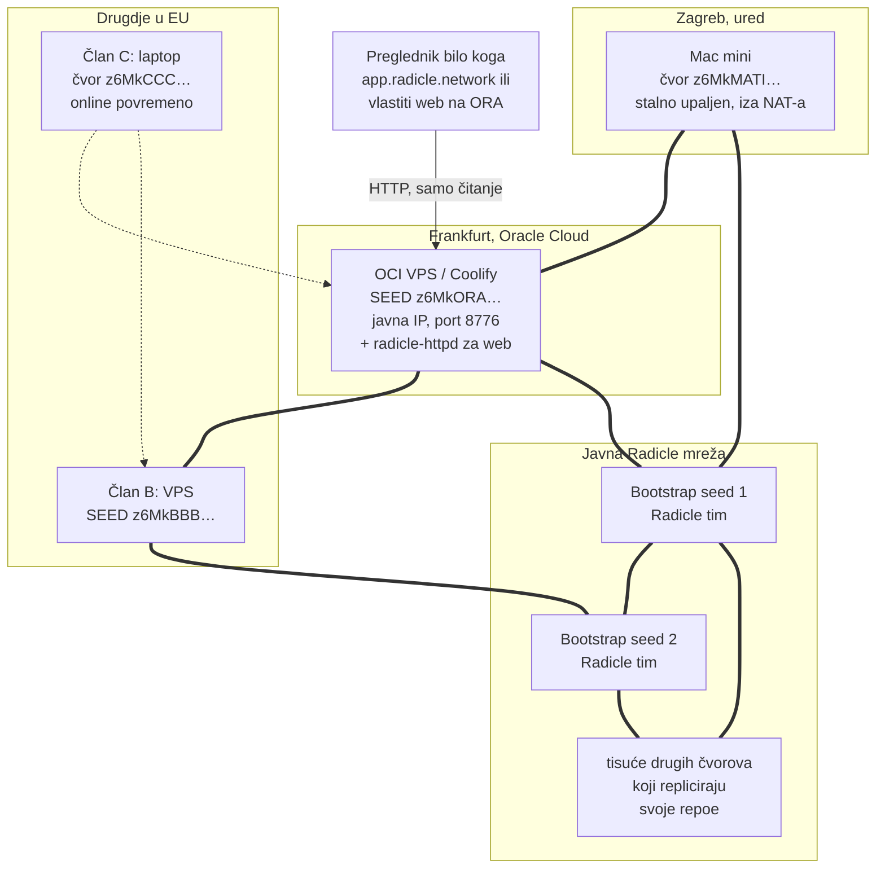

Što se šalje po linijama:

| Poruka | Sadržaj | Kad |
|---|---|---|
| **Node announcement** | „Ja sam NID X, dostupan na adresi Y” | pri spajanju, periodički |
| **Inventory announcement** | „Repliciram RID-ove A, B, C” | kad počnem ili prestanem pratiti repo |
| **Refs announcement** | „U repou A moji su refovi sada na hashu H” | nakon `git push rad` |
| **Git fetch** | Stvarni git objekti, *izravno* od čvora koji ih ima | kad primim najavu za repo koji pratim |

Svaki čvor iz inventory najava gradi vlastitu **tablicu usmjeravanja**: za
svaki RID zna koji ga čvorovi imaju. Ne postoji globalni registar repoa.

---

## 4. Ljudi, ključevi, uređaji, čvorovi

Lijevo su stvarni ljudi, u sredini kriptografski identiteti, desno procesi
na računalima. Strelice pokazuju „posjeduje / pokreće”. Desni stupac
pokazuje kako identitet ulazi u repo.

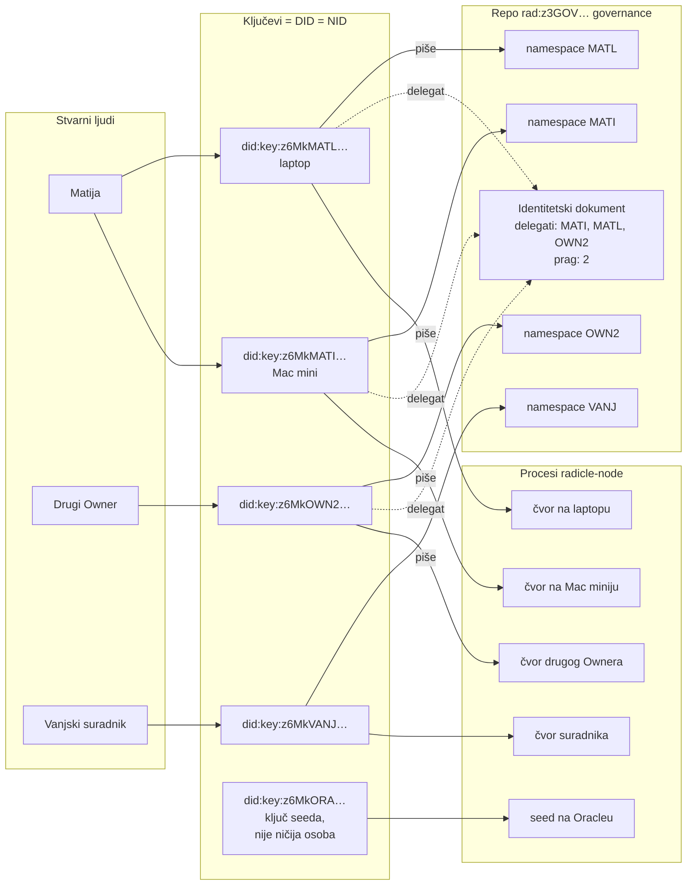

Napomene:

- **Seed ima vlastiti ključ, ali ne mora biti delegat.** On samo replicira i
  poslužuje. Nema nikakvu vlast nad repoom. Ako Oracle ugasi VPS, gubi se
  jedna kopija, nikakvo pravo.
- **Vanjski suradnik ima svoj namespace** u istom repou čim objavi patch, ali
  nije delegat. Njegove grane se vide, ali ne utječu na kanonski `main`.
- **Prag 2 od 3 ključa** u primjeru je malo varljiv: dva od tri ključa
  pripadaju Matiji, pa bi on sam mogao ispuniti prag. U pravoj postavi
  osoba treba imati **jedan delegatski ključ**, ili prag treba računati s
  tim (vidi [§11](#11-primjer-catholicit-na-radicleu)).

---

## 5. Unutar jednog čvora: storage i repoi

Jedan čvor drži mnogo repoa. Koje će repoe replicirati odlučuje **seeding
policy** tog čvora. Vlasnik čvora sam odlučuje što hostira. Nitko mu ne
može narediti da nešto čuva ili obriše.

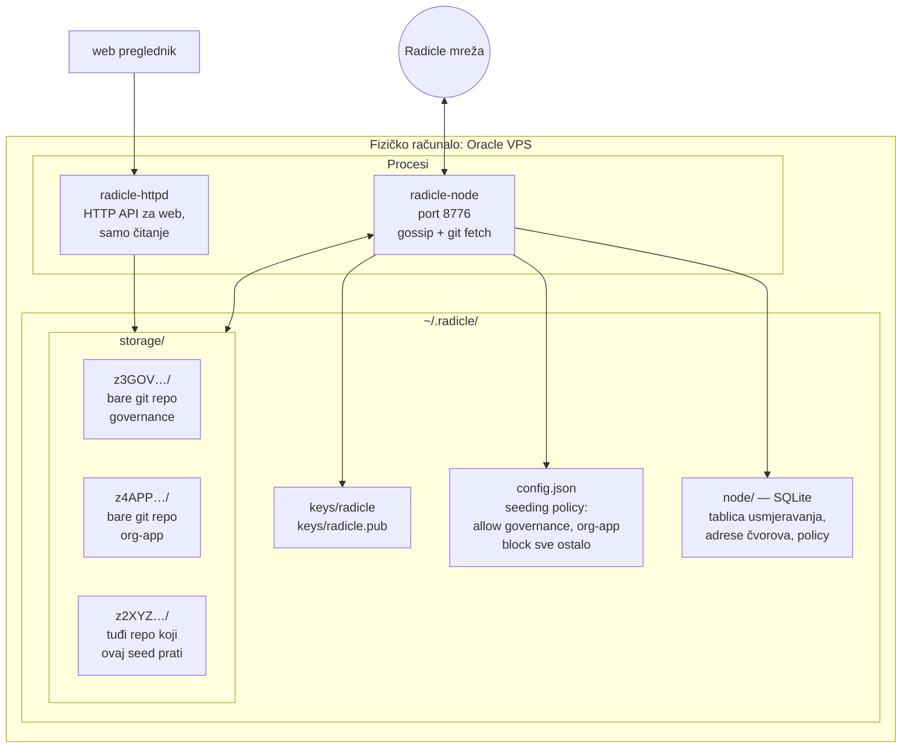

A ovako izgleda isto na računalu developera, gdje postoji i **radna kopija**:

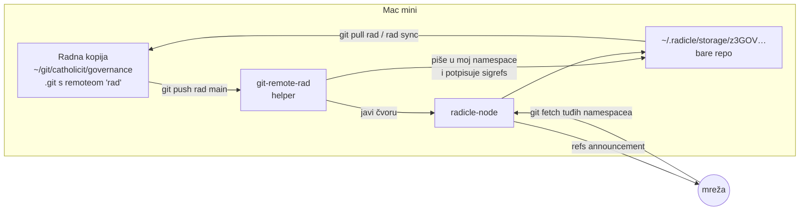

Ključni detalj: `git push rad` **ne ide na mrežu, nego u lokalni storage**.
Mreža tek nakon toga dozna da postoji nešto novo i sama to povuče. Zato
Radicle radi i offline: commitaš, pushaš, otvaraš issue, a sve se
sinkronizira kad se spojiš.

---

## 6. Unutar jednog repoa: prostori imena i refovi

Ovo je stvarna struktura refova u jednom *bare* repou u storageu. Svaki
sudionik ima podstablo `refs/namespaces/<NID>/`. Git objekti (commitovi,
stabla, blobovi) dijele se, a refovi su odvojeni.

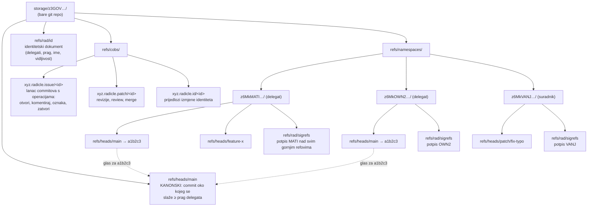

Kako se izračuna kanonski `main`: delegati MATI i OWN2 imaju svoj `main`
na istom commitu `a1b2c3`. Prag je 2, pa je kanonski `main` = `a1b2c3`.
Suradnikove grane ne broje se jer on nije delegat.

**Dvije razine potpisa:**

| Što se potpisuje | Čime | Što dokazuje |
|---|---|---|
| `sigrefs` | uvijek, automatski, Radicle ključem | „Ovi refovi u mom namespaceu su moji, nitko ih nije podmetnuo” |
| sam commit | opcionalno, git SSH potpisom istim ključem | „Ja sam autor ovog commita” |

Sigrefs štiti **objavu**: tko je rekao da je grana tu. Potpis commita štiti
**autorstvo**. Za organizaciju je razumno tražiti oboje.

---

## 7. Model entiteta (ER)

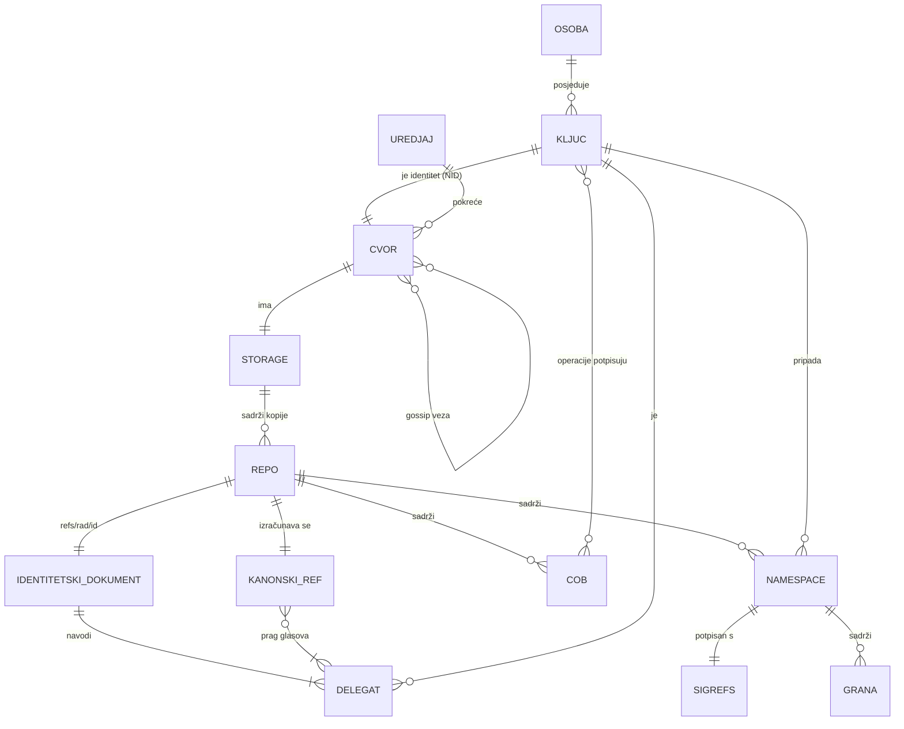

Kako čitati važne veze:

- **Repo nije na jednom mjestu.** `STORAGE ||--o{ REPO` znači da svaki čvor
  koji prati repo ima *svoju punu kopiju*. Isti RID postoji na N računala.
- **`KLJUC ||--|| CVOR`** znači: jedan ključ, jedan identitet čvora. Osoba
  može imati više ključeva (`OSOBA ||--o{ KLJUC`).
- **`KANONSKI_REF`** nije pohranjen kao autoritet nego se izračunava. Dva
  čvora s istim podacima uvijek izračunaju isti rezultat.

---

## 8. Tok: od commita do kanonskog `main`a

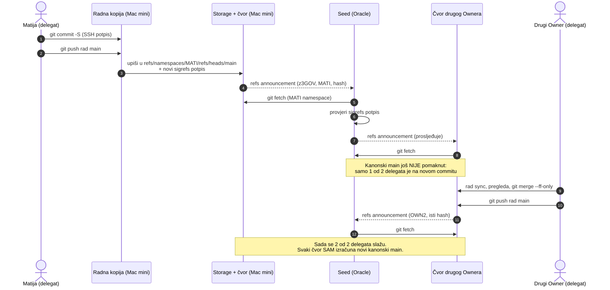

Usporedba s GitHubom: na GitHubu „merge” znači da server promijeni jedan
ref. Ovdje „merge” znači da **dovoljno delegata u svojim potpisanim
namespaceima pokaže na isti commit**. To je multisig nad Gitom.

---

## 9. Tok: patch od nedelegata

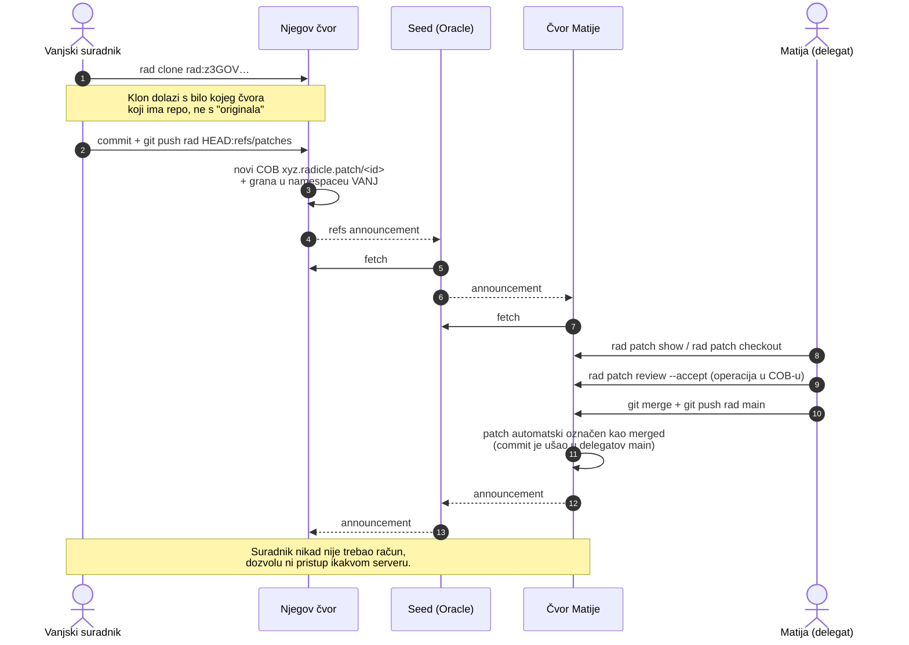

---

## 10. Isti repo, različit pogled sa svakog čvora

Radicle je **eventualno konzistentan**. U danom trenutku čvorovi mogu imati
različit podskup namespacea. Kanonski `main` se svugdje izračuna istim
pravilom, pa se slože čim imaju iste podatke.

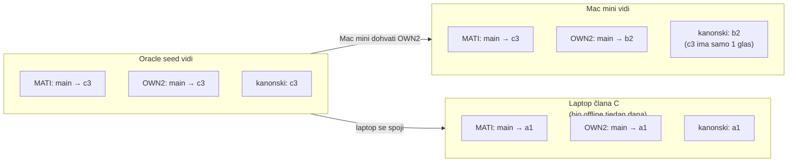

Nakon sinkronizacije sva tri čvora izračunaju `c3`. Nema glasanja *mreže* i
nema „najdužeg lanca”. Svaki repo ima svoje delegate i svoj prag, i to je
cijeli „konsenzus”. Zato blockchain nije potreban.

---

## 11. Primjer: `catholicit` na Radicleu

Kako bi se postojeći model (Safe multisig + GitHub + Peribolos) preslikao na
Radicle:

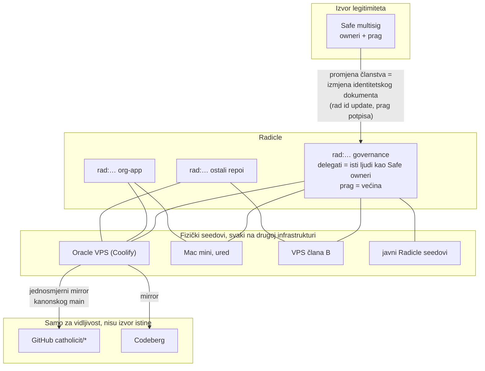

Pravila koja iz toga slijede:

1. **Jedan delegatski ključ po osobi.** Isti ljudi kao Safe owneri, svatko
   svoj ključ generira sam. Dodatni uređaji sinkroniziraju radne kopije, ali
   ne dobivaju delegatski ključ, da prag ostane stvarni broj ljudi.
2. **Prag = većina delegata**, isto pravilo kao glasanje u `governance.yml`.
3. **Izmjena članstva je izmjena identitetskog dokumenta**, koju također
   moraju potpisati delegati do praga. Odluka u Safeu i izmjena u Radicleu
   trebaju se poklapati (isti uzorak kao „GitHub == Safe?” u
   [arhitektura.md](arhitektura.md)).
4. **Barem tri seeda na tri različite infrastrukture**, da ni Oracle, ni ured,
   ni ijedan član ne budu nužni.
5. **GitHub postaje ogledalo**: push ide samo s Radiclea prema GitHubu, nikad
   obrnuto.
6. **Za sada samo javni repoi.** Vidi [§12](#12-što-ni-radicle-ne-decentralizira).

---

## 12. Što ni Radicle ne decentralizira

| Ovisnost | Zašto postoji | Ublažavanje |
|---|---|---|
| **Bootstrap seedovi** Radicle tima | Novi čvor mora znati bar jednu adresu | U config dodati vlastite seedove; tada tim nije nužan |
| **Javna IP / NAT** | Čvor iza routera ne prima dolazne veze | Bar jedan seed s javnom adresom (Oracle), Tor ili I2P adrese (podržano od 1.9) |
| **DNS za web prikaz** | `app.radicle.network` i vlastiti httpd rade preko domene | Web je samo prikaz; protokol radi i bez njega |
| **Privatni repoi** | Objavljena je ranjivost: čvorovi šalju privatne repoe nešifrirano | Za sada samo javni repoi; čekati Radicle 2.0 (QUIC + TLS) |
| **Prelazak na 2.0** | Čvorovi 1.x i 2.x se neće moći međusobno spojiti | Planirati jednu koordiniranu nadogradnju svih seedova |
| **CI** | Protokol ga nema | Radicle CI broker ili Forgejo Actions runner koji prati Radicle |
| **Gubitak ključa** | Nema „zaboravljene lozinke” | Prag < broj delegata, pa ostali delegati mogu izmijeniti identitet i zamijeniti izgubljeni ključ |
| **Platforme** | Linux, macOS, BSD; Windows ne | |

---

## 13. Tim kroz vrijeme: dolasci i odlasci

Radicle **nema pojam organizacije ni tima**, samo repoe s delegatima. Postoji
jedna javna Radicle mreža (radicle.network je domena projekta, ne zasebna
mreža). „Naša mreža” je samo podgraf: čvorovi koji seedaju RID-ove iz našeg
registra.

**Developer ne treba dozvolu da bi doprinosio.** Svatko s ključem može
klonirati repo i objaviti patch u svoj namespace. Popis treba voditi samo za
one koji smiju mergeati (delegate).

| Uloga | Koliko | U Radicleu |
|---|---|---|
| Suradnik | cijeli tim + bilo tko izvana | ništa osim `rad auth` |
| Delegat (maintainer) | 3–5 po repou | DID u identitetskom dokumentu |
| Prag | npr. 2/3 ili 3/5 | broj u identitetskom dokumentu |

Ne raditi 11 delegata s pragom 6. Prag vrijedi i za merge i za izmjenu
identiteta, pa bi svaki merge tražio šest ljudi.

| Događaj | Radnja | Tko potpisuje |
|---|---|---|
| novi suradnici | samo `org.yaml` (evidencija) + follow na seedovima | nitko |
| novi maintainer | `rad id update --delegate did:key:…` u svakom repou | prag postojećih delegata (`rad id accept`) |
| maintainer ode / izgubi ključ | `rad id update` bez njegovog DID-a | prag ostalih, bez njega |
| povijest odlazećeg | ostaje valjana, samo više ne glasa | |

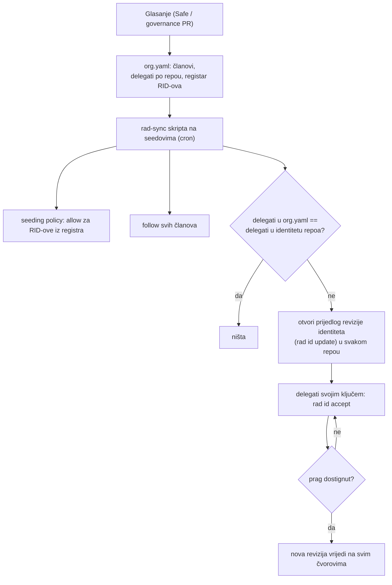

Bot **ne smije** potpisivati umjesto delegata, jer bi tada bot bio vlast
(ista granica kao kod Safea). Automatizira se sve osim potpisa.

Seedovi za javni open source: scope `all` za RID-ove iz registra (da patchevi
vanjskih suradnika stignu bez dogovora), `block` za spam čvorove, barem tri
seeda na tri infrastrukture.

---

## 14. Disk i otkrivanje: usporedba s blockchain čvorom

Radicle **nema globalnog stanja**. Čvor čuva samo repoe koje sam seeda. Za
usporedbu, Gnosis arhivski čvor (Nethermind, godinu dana povijesti) treba
~250 GB jer čuva stanje cijele mreže.

| Dio na disku seeda | Veličina |
|---|---|
| naši repoi (RID-ovi iz registra) | koliko su veliki |
| forkovi suradnika (namespacei u istom repou) | mali, git dijeli objekte |
| issues, patchevi (COB) | zanemarivo |
| tablica usmjeravanja (SQLite: RID → čvorovi, adrese) | reda MB, raste s brojem čvorova i repoa, ne s njihovom veličinom |
| tuđi repoi | 0, osim ako ih eksplicitno seedamo |

Otkrivanje: bootstrap seedovi → node announcements (adrese) → inventory
announcements (tko ima koji RID, samo popis) → `rad clone` povuče sadržaj
izravno od čvora koji ga ima. **Nema globalne pretrage**, pa RID treba
objaviti u README-u ogledala na GitHubu ili Codebergu i na webu.

Procjena: 20 repoa (jedan 2 GB, ostali ~50 MB) s desetcima suradnika je
~3–4 GB po seedu. Dovoljni su Mac mini ili Oracle Free Tier.

| Rizik | Kontrola |
|---|---|
| spam od 10 GB u nečijem namespaceu uz scope `all` | ograničenje veličine fetcha u configu, `block` NID, ili scope `followed` |
| binarne datoteke u gitu | ne držati ih u gitu; službenog Git LFS-a nema |
| napušteni forkovi | čišćenje namespacea koji nisu delegati ni praćeni |
| seed koji slučajno seeda sve | default policy `block`, `allow` samo iz registra |

---

## 15. Codeberg i Radicle

Codeberg je **centralni hosting u vlasništvu zajednice** (Codeberg e.V.,
Berlin, Forgejo). Radicle je **protokol bez vlasnika**.

| | Codeberg | Radicle |
|---|---|---|
| model | jedna hostana instanca | P2P, kod na svakom čvoru koji ga seeda |
| identitet | račun (e-mail, lozinka, 2FA) | Ed25519 ključ (`did:key`) |
| tko te može izbaciti | udruga, po pravilima korištenja (npr. neslobodna licenca) | nitko; pojedini seed može odbiti repo |
| pravo merganja | dozvole u bazi servera | delegati + prag u potpisanom dokumentu |
| upravljanje | skupština članova udruge | svaki repo sam |
| issues / PR | u bazi servera | COB-ovi u repou, rade offline |
| CI, Pages | Forgejo Actions / Woodpecker, Codeberg Pages | nema ugrađeno |
| otkrivanje | pretraga, explore | slabo |
| točka kvara | jedna institucija, jurisdikcija, datacentar | bootstrap seedovi (zaobilazivo), DNS za web |
| suverenost | institucionalna (vjeruješ udruzi) | kriptografska (vjeruješ ključevima) |

Vlastiti Forgejo na Coolifyju je treća varijanta: suverenost operatera, uz
ovisnost o Oracleu kao infrastrukturi.

Uloge za `catholicit`: **Radicle** je izvor istine za kod i merge, **Safe**
za članstvo i odluke, **Codeberg i GitHub** su ogledala za vidljivost, a CI
ide na vlastiti runner.

---

## 16. Izvori i što još treba provjeriti

- [radicle.dev](https://radicle.dev/), glavna stranica od 23.04.2026.
  (prije radicle.xyz)
- [Radicle Protocol Guide](https://radicle.dev/guides/protocol)
- [Radicle 1.9.0](https://radicle.dev/2026/05/19/radicle-1.9.0) (I2P, Tor)
- [docs.radicle.xyz](https://docs.radicle.xyz)
- [Ranjivost: privatni repoi nešifrirano](https://maninak.com/blog/radicle-cleartext-transport-vulnerability/)
- [Arch Wiki: Radicle](https://wiki.archlinux.org/title/Radicle)

Ovaj dokument je napisan prema Protocol Guideu i općem poznavanju
Heartwooda, bez lokalno instaliranog `rad`. Nakon `rad init` na Mac miniju
treba provjeriti i po potrebi ispraviti:

- točne nazive refova: `git -C ~/.radicle/storage/<RID> for-each-ref`
- oblik identitetskog dokumenta: `rad inspect --identity`
- da su DID i NID isti ključ: `rad self`
- trenutne bootstrap seedove i njihove domene: `rad config`
- canonical reference rules (prag po grani) u 1.10.x
- točan naziv opcije za ograničenje veličine fetcha i naredbu za čišćenje
  namespacea; default seeding policy
- stvarna potrošnja diska i veličina baze nakon seedanja jednog javnog repoa
